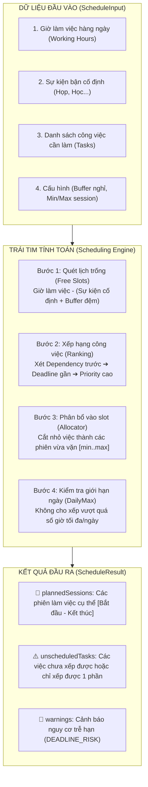

# Giải thích Chi tiết về Module Scheduling Engine (Dành cho toàn bộ thành viên nhóm)

> **Dành cho:** Tất cả thành viên đồ án (Thành viên A - Backend, Thành viên C - Frontend) và phục vụ báo cáo với Giảng viên.  
> **Mục đích:** Giúp bất kỳ ai trong nhóm, dù không trực tiếp viết code thuật toán, vẫn có thể nắm vững 100% nguyên lý hoạt động, cách kết nối và tự tin phản biện đồ án.

---

## 1. 💡 Module này giải quyết bài toán gì? (Ví dụ đời thường)

Hãy tưởng tượng bạn có một ngày làm việc:
- Bạn chỉ rảnh từ **08:00 – 12:00** và **13:30 – 17:30**.
- Bạn có một cuộc họp đột xuất lúc **09:00 – 10:30**.
- Bạn có 3 việc cần làm: 
  1. *Soạn slide thuyết trình* (Cần 2 tiếng, hạn chót hôm nay).
  2. *Tập thuyết trình thử* (Cần 1 tiếng — **phải làm sau khi soạn xong slide**).
  3. *Viết báo cáo tuần* (Cần 3 tiếng, hạn chót cuối tuần).

👉 **Người dùng bình thường sẽ rất đau đầu:** *Nên làm việc nào trước? Cuộc họp xong có nên lao vào làm việc ngay không hay cần nghỉ giải lao 15 phút? Nếu hết giờ làm việc thì việc nào bị dời lại?*

🎯 **Nhiệm vụ của `Scheduling Engine`:**  
Thay vì để người dùng tự tính bằng tay, module này đóng vai trò như một **"Trợ lý thư ký thông minh"**:
Tự động quét lịch trống, tính toán các ràng buộc (thời hạn, việc nào phải làm trước, thời gian đệm giải lao, giới hạn không làm việc quá sức trong ngày) và xuất ra một **thời khóa biểu chi tiết từng phút**, sẵn sàng vẽ lên màn hình Calendar.

---

## 2. 🔄 Toàn bộ quy trình hoạt động trong 1 bức tranh



---

## 3. 🧠 4 Bước xử lý cốt lõi của Thuật toán (Rất dễ hiểu)

### Bước 1: Thuật toán tìm khoảng trống (Free Slots)
- Giống như trò chơi ghép hình: Hệ thống lấy tổng khung giờ làm việc của bạn (ví dụ: 8h - 12h), sau đó **khoét đi** những khoảng đã có lịch họp.
- **Điểm thông minh (Buffer):** Trước và sau mỗi cuộc họp cố định, hệ thống tự động cộng thêm một khoảng đệm an toàn (ví dụ: `15 phút`). Giúp người dùng có thời gian chuẩn bị hoặc di chuyển, không bị tình trạng vừa họp xong 10:30 là 10:30 phải làm việc ngay.

### Bước 2: Quy tắc xếp hạng công việc (Ai được ưu tiên làm trước?)
Hệ thống không chọn bừa bãi hay dựa vào "cảm tính", mà tuân thủ nghiêm ngặt 4 luật sau:
1. **Ràng buộc phụ thuộc (Dependency):** Việc B cần việc A làm xong trước $\rightarrow$ Việc B **bắt buộc** phải chờ A làm xong mới được xếp lịch.
2. **Hạn chót (Deadline):** Việc nào sắp đến hạn chót hơn sẽ được ưu tiên xếp vào khung giờ sớm hơn.
3. **Mức độ ưu tiên (Priority):** Nếu hai việc cùng hạn chót, việc có mức `URGENT` / `HIGH` sẽ được xếp trước việc `LOW`.
4. **Tính ổn định (FIFO):** Nếu mọi thứ bằng nhau, việc nào tạo ra trước (`createdAt`) sẽ làm trước.

### Bước 3: Cắt nhỏ phiên làm việc (Session Slicing)
- Người dùng không thể ngồi tập trung liên tục một task dài 5 tiếng.
- Hệ thống áp dụng quy tắc:
  - **`minSessionMinutes` (mặc định 30 phút):** Nếu slot trống quá ngắn (ví dụ chỉ có 15 phút), hệ thống sẽ bỏ qua, không xếp việc vào vì không đủ thời gian tập trung sâu.
  - **`maxSessionMinutes` (mặc định 120 phút):** Một task dài 4 tiếng sẽ được thuật toán tự động chia thành 2 session (mỗi session 2 tiếng) vào các khung giờ khác nhau.

### Bước 4: Xử lý tình huống khó (Phiên bị khóa & Quá tải)
- **Phiên đã khóa (`LockedSession`):** Người dùng chủ động ghim chặt một việc vào khung giờ cố định trên giao diện $\rightarrow$ Thuật toán **tuyệt đối không tự ý di chuyển** phiên này, mà sẽ xếp các việc khác né khung giờ đó ra.
- **Quá tải / Thiếu thời gian:** Nếu khối lượng công việc vượt quá số giờ trống trong tuần, thuật toán sẽ:
  - Cố gắng xếp tối đa những gì có thể (`PARTIALLY_SCHEDULED`).
  - Ghi nhận số phút còn thiếu vào danh sách `unscheduledTasks`.
  - Bắn ra cảnh báo `DEADLINE_RISK` để người dùng biết mà lùi deadline hoặc nhờ người khác hỗ trợ.

---

## 4. 🤝 Hướng dẫn kết nối cho Thành viên A (Backend / NestJS / Prisma)

Thành viên A phụ trách tạo API và lưu Database. Engine đã được đóng gói sẵn thành một **NestJS Service**:

```typescript
// Trong NestJS Controller hoặc Service của A:
import { SchedulingService } from './scheduling.service';

@Injectable()
export class TaskSchedulerService {
  constructor(private readonly schedulingService: SchedulingService) {}

  async autoScheduleUserTasks(userId: string) {
    // 1. A lấy dữ liệu từ PostgreSQL qua Prisma:
    const tasks = await prisma.task.findMany({ where: { userId } });
    const events = await prisma.calendarEvent.findMany({ where: { userId } });
    const workingHours = await prisma.workingHours.findMany({ where: { userId } });

    // 2. A đóng gói thành ScheduleInput và gọi hàm:
    const result = this.schedulingService.generateSchedule({
      now: new Date().toISOString(),
      tasks: tasks.map(t => ({
        id: t.id,
        title: t.title,
        estimatedMinutes: t.estimatedMinutes,
        remainingMinutes: t.remainingMinutes,
        deadline: t.deadline?.toISOString() ?? null,
        priority: t.priority,
        status: t.status,
        dependencyIds: t.dependencies.map(d => d.predecessorId),
        createdAt: t.createdAt.toISOString()
      })),
      busyIntervals: events.map(e => ({ id: e.id, start: e.start.toISOString(), end: e.end.toISOString(), type: 'CALENDAR_EVENT' })),
      workingHours: workingHours,
      lockedSessions: [],
      settings: {
        planningHorizonDays: 7,
        minSessionMinutes: 30,
        maxSessionMinutes: 120,
        bufferMinutes: 15,
        dailyMaxMinutes: 480
      }
    });

    // 3. A lưu các session đã xếp vào Database:
    for (const session of result.plannedSessions) {
      await prisma.workSession.create({
        data: {
          taskId: session.taskId,
          startTime: new Date(session.start),
          endTime: new Date(session.end),
          isLocked: session.locked
        }
      });
    }

    // 4. Trả kết quả về cho Frontend:
    return result;
  }
}
```

---

## 5. 🎨 Hướng dẫn kết nối cho Thành viên C (Frontend / React / Calendar)

Thành viên C phụ trách vẽ giao diện Calendar và hiển thị kết quả cho người dùng:

1. **Hiển thị các khối màu trên Lịch tuần (`Calendar.tsx` / `FullCalendar`):**
   - Sự kiện cố định (`BusyInterval`): Màu xanh lá / xám (Ví dụ: Họp, học nhóm).
   - Phiên làm việc do hệ thống xếp (`PlannedSession`): Màu xanh dương (Có ghi rõ thời lượng, ví dụ: `60m`).
   - Phiên đã khóa (`LockedSession`): Màu xanh dương có icon ổ khóa 🔒 (Không cho kéo thả tùy tiện).
2. **Nút bấm "Tự động lập lịch" (Auto-Schedule):**
   - Trên thanh công cụ của Calendar, C chỉ cần tạo nút bấm `⚡ Lập lịch thông minh`.
   - Khi bấm, gửi request về Backend của A $\rightarrow$ Nhận về `plannedSessions` $\rightarrow$ Render lại lịch ngay lập tức!
3. **Hiển thị cảnh báo (Warning Banner):**
   - Nếu `result.warnings` có cảnh báo `DEADLINE_RISK` hoặc `PARTIALLY_SCHEDULED`:
   - Hiển thị thông báo nhỏ màu vàng cam: *"⚠️ Chú ý: Bạn có 1 công việc không đủ thời gian hoàn thành trước hạn chót (Thiếu 60 phút)."*

---

## 6. 💬 Các câu hỏi thường gặp khi Báo cáo / Thuyết minh (FAQ)

### Q1: Tại sao không dùng AI (ChatGPT/LLM) hay Thuật toán Di truyền (Genetic Algorithm) để lập lịch?
> **Trả lời:**  
> - **AI/LLM:** Chạy chậm (vài giây), tốn chi phí API, kết quả không ổn định (cùng 1 input mỗi lần bấm lại ra một lịch khác nhau), và dễ bị ảo giác (chồng lấn giờ).
> - **Thuật toán Di truyền / Tối ưu hóa phức tạp:** Khó kiểm soát giải thích lý do tại sao công việc này bị đẩy lùi.
> - **Thuật toán Deterministic Rule-Based của nhóm:** Chạy siêu nhanh (**chỉ mất ~1.3 mili-giây**), kết quả luôn chính xác 100%, có thể giải thích rõ ràng từng quyết định cho người dùng, và cực kỳ dễ viết Unit Test chứng minh.

### Q2: Thuật toán có tránh được tình trạng người dùng làm việc kiệt sức không?
> **Trả lời:** Có. Nhờ tham số `dailyMaxMinutes` (ví dụ: tối đa 6 tiếng/ngày). Nếu trong ngày đã xếp đủ 6 tiếng, thuật toán sẽ tự động đẩy các công việc tiếp theo sang ngày hôm sau dù ngày hôm đó vẫn còn thời gian trống.

### Q3: Bộ kiểm thử (Testing) đã đạt chuẩn chưa?
> **Trả lời:** Đã viết đầy đủ bằng **Vitest** (chuẩn của dự án). Đã kiểm thử 100% các ca khó: vòng lặp phụ thuộc, gộp khoảng bận, áp dụng buffer đệm, bảo vệ phiên khóa, và cảnh báo khi hết slot.
